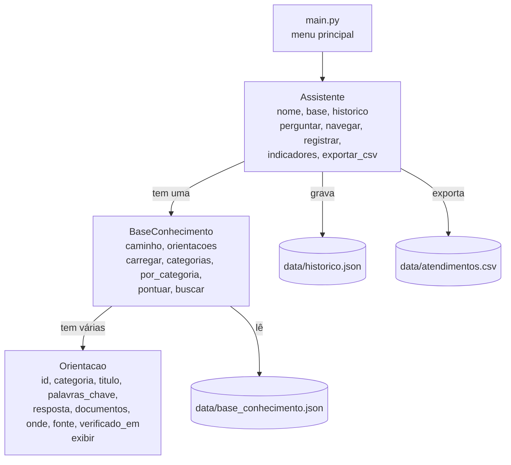

<h1 align="center">Ponto Vivo</h1>

<p align="center">
  <strong>O ponto de ônibus que enxerga quem a cidade não enxerga.</strong><br />
  Assistente digital que orienta passageiros de ônibus de São Paulo sobre tarifas, direitos, viagem, calor, alagamentos e energia, sempre com fonte.
</p>

<p align="center">
  
  
  
  
</p>

> **Aviso:** este assistente **não é um canal oficial** da Prefeitura de São Paulo nem da SPTrans. As respostas resumem informações públicas e mostram a fonte e a data em que foram conferidas.

---

## Índice

- [O que é](#o-que-é)
- [Público e problema](#público-e-problema)
- [Como funciona o atendimento](#como-funciona-o-atendimento)
- [Funcionalidades](#funcionalidades)
- [Arquitetura](#arquitetura)
- [Base de conhecimento](#base-de-conhecimento)
- [Regra de pontuação](#regra-de-pontuação)
- [Dados pessoais e transparência](#dados-pessoais-e-transparência)
- [Estrutura de pastas](#estrutura-de-pastas)
- [Como rodar](#como-rodar)
- [Histórico e indicadores](#histórico-e-indicadores)
- [Teste com usuários](#teste-com-usuários)
- [Integrações com outras disciplinas](#integrações-com-outras-disciplinas)
- [ODS relacionados](#ods-relacionados)
- [Limitações](#limitações)
- [Fontes consultadas](#fontes-consultadas)
- [Vídeo técnico](#vídeo-técnico)
- [Integrante](#integrante)
- [Sobre mim](#sobre-mim)

## O que é

O **Ponto Vivo** é um projeto da Global Solution 2026.2 (FIAP, 1º ano de Ciência da Computação, desafio CitizenTech / Citizen Assist AI). A ideia completa é um ponto de ônibus movido a energia solar, com ventilador automático, que conta quantas pessoas estão esperando, mostra o tempo estimado de espera e manda esses dados para a prefeitura redistribuir a frota.

Este repositório guarda o **cérebro do assistente**: um programa em Python, executado no terminal, que responde dúvidas do passageiro usando uma base de conhecimento verificada. Na versão completa, o passageiro chega até ele escaneando o QR code do ponto.

## Público e problema

**Público:** passageiros de ônibus da cidade de São Paulo, com atenção especial a **pessoas idosas, pessoas com deficiência e estudantes**, que são quem mais tem direitos a descobrir e quem mais sofre esperando no ponto.

**Problema:** a informação existe, mas está espalhada em várias páginas da SPTrans, do Portal 156 e da Prefeitura, escrita em linguagem técnica. O passageiro não sabe se tem direito à gratuidade, quantos ônibus pode pegar com uma tarifa, onde reclamar quando o ônibus passa direto ou o que fazer quando o ponto alaga ou o calor está forte.

## Como funciona o atendimento

1. **Pergunte do seu jeito.** O passageiro digita a dúvida em texto livre, por exemplo "idoso paga ônibus?".
2. **O assistente procura na base.** Cada orientação recebe pontos conforme as palavras da pergunta.
3. **Resposta com confiança e fonte.** Aparece a melhor orientação, até duas alternativas, os documentos necessários, onde ir, a fonte oficial e a data da verificação.
4. **Ou navegue por categoria.** Quem não sabe o que perguntar escolhe uma categoria e uma orientação numerada.

Exemplo esperado no terminal:

```
Digite sua dúvida (0 para voltar): o onibus é de graça no domingo?

Confiança da resposta: ALTA (8 pontos)

>> Domingão Tarifa Zero: ônibus de graça aos domingos  [Tarifas e Direitos]
Todos os domingos, das 0h às 23h59, os ônibus municipais de São Paulo são de graça...
Documentos necessários:
  - Nenhum documento é necessário
Onde: Qualquer ônibus municipal da SPTrans
Fonte: https://www.sptrans.com.br/perguntas-e-respostas/?sobre=tarifa-zero (verificado em 2026-11-05)
Aviso: este assistente NÃO é um canal oficial.

Essa orientação respondeu sua dúvida? (s/n):
```

## Funcionalidades

- [x] Base de conhecimento em JSON com 15 orientações, 4 categorias e fontes
- [x] Opção "Energia do Ponto Vivo" com a análise de energia do abrigo
- [x] Classes `Orientacao`, `BaseConhecimento` e `Assistente` ligadas por composição
- [x] Busca em texto livre com normalização (sem acentos, sem pontuação, minúsculas)
- [x] Pontuação por palavras-chave e título, com nível de confiança ALTA ou MÉDIA
- [x] JSON ausente ou corrompido não trava o programa
- [x] Melhor resposta e até duas alternativas
- [x] Navegação por categorias, com "0 para voltar" em todas as telas
- [x] Entradas inválidas nunca encerram o programa
- [x] Bloqueio de dados pessoais (CPF, telefone, e-mail)
- [x] Histórico em `data/historico.json` e exportação para `data/atendimentos.csv`
- [x] Indicadores de acerto, tempo, tentativas e facilidade de uso

## Arquitetura

As três classes se encaixam por composição: o assistente tem uma base, e a base tem uma lista de orientações.



| Classe             | O que representa                    | Responsabilidade                                                  |
| ------------------ | ----------------------------------- | ----------------------------------------------------------------- |
| `Orientacao`       | Uma informação da base (um registro) | Guardar os dados de uma orientação e exibi-la na tela             |
| `BaseConhecimento` | O conjunto de orientações           | Ler o JSON, listar categorias e buscar a melhor orientação        |
| `Assistente`       | Quem conversa com o passageiro      | Fazer o atendimento, guardar o histórico e calcular indicadores   |

## Base de conhecimento

O assistente **só responde com o que está** em [`data/base_conhecimento.json`](data/base_conhecimento.json). Cada orientação tem `id`, `categoria`, `titulo`, `palavras_chave`, `resposta`, `documentos`, `onde`, `fonte` e `verificado_em`.

| ID  | Categoria           | Orientação                                                  |
| --: | ------------------- | ----------------------------------------------------------- |
| 1   | Tarifas e Direitos  | Gratuidade no ônibus para pessoas de 60 a 64 anos           |
| 2   | Tarifas e Direitos  | Bilhete Único Especial da Pessoa Idosa (65 anos ou mais)    |
| 3   | Tarifas e Direitos  | Bilhete Único de Estudante (meia tarifa ou gratuidade)      |
| 4   | Tarifas e Direitos  | Bilhete Único Especial da Pessoa com Deficiência            |
| 5   | Tarifas e Direitos  | Atende+: transporte porta a porta                           |
| 6   | Tarifas e Direitos  | Domingão Tarifa Zero: ônibus de graça aos domingos          |
| 7   | Viagem e Informação | Integração do Bilhete Único: quantos ônibus com uma tarifa  |
| 8   | Viagem e Informação | Onde e como recarregar o Bilhete Único                      |
| 9   | Viagem e Informação | Saber quando o ônibus vai chegar (Olho Vivo)                |
| 10  | Viagem e Informação | Reclamar de ônibus que demorou ou não parou no ponto        |
| 11  | Clima e Segurança   | O que fazer com alagamento no caminho ou no ponto           |
| 12  | Clima e Segurança   | Calor forte esperando o ônibus: como se proteger            |
| 13  | Energia e Sustentabilidade | Ponto Fresco: o ventilador movido a energia solar    |
| 14  | Energia e Sustentabilidade | Por que o ventilador liga só com calor e gente esperando |
| 15  | Energia e Sustentabilidade | Ônibus ou carro: quanto CO2 você deixa de emitir     |

Regras seguidas na base:

- Toda orientação tem **fonte** (SPTrans, Portal SP156, Prefeitura, Governo de SP, Ministério da Saúde, INMET, CRESESB ou Metrô de SP) e a **data em que foi conferida**. As orientações de energia (13 a 15) usam os cálculos da pasta [`energia/`](energia/) e avisam que são estimativas de um projeto acadêmico.
- Respostas em **linguagem simples**, sem inventar informação. Quando as fontes divergiam em algum detalhe (por exemplo, prazos), o detalhe ficou de fora.
- Palavras-chave escritas **sem acento e em minúsculas**, do jeito que o passageiro costuma perguntar ("de graca", "passou direto", "meia passagem").

## Regra de pontuação

A pergunta, as palavras-chave e o título são normalizados antes da comparação: tudo em minúsculas, sem acentos e sem pontuação.

```
pontos = 3 × (palavras-chave da orientação que aparecem na pergunta)
       + 1 × (palavras da pergunta com 4 letras ou mais que aparecem no título)
```

| Pontos da melhor orientação | Resultado                                              |
| --------------------------: | ------------------------------------------------------ |
| 6 ou mais                   | Confiança **ALTA**                                     |
| 3 a 5                       | Confiança **MÉDIA**                                    |
| menos de 3                  | "Não encontrei": sugere outras palavras e as categorias |

Exemplo: em "o onibus é de graça no domingo?", a orientação 6 recebe +3 por `domingo`, +3 por `de graca`, +1 porque "onibus" está no título e +1 porque "graca" está no título: **8 pontos, confiança ALTA**. As palavras são comparadas inteiras: "domingo" não conta dentro de "domingos".

O método `buscar()` devolve uma lista de tuplas `(pontos, orientacao)`, da maior para a menor pontuação.

## Dados pessoais e transparência

- O assistente **nunca pede** nome, CPF, telefone ou e-mail.
- Pergunta com **8 ou mais dígitos** ou com **@** é recusada e **não é registrada** no histórico.
- Toda resposta mostra a **fonte**, a **data de verificação** e o aviso de que o assistente **não é canal oficial**.
- O histórico guarda só a pergunta, a orientação, se ajudou, as tentativas e o tempo. Nenhum dado de quem perguntou.

## Estrutura de pastas

```
ponto-vivo-citizen-assist-ai/
├── README.md
├── main.py                     # Ponto de entrada e menu principal
├── orientacao.py               # Classe Orientacao
├── base_conhecimento.py        # Classe BaseConhecimento: lê o JSON, normaliza e pontua
├── assistente.py               # Classe Assistente: atendimento, histórico e indicadores
├── tela.py                     # Aparência do terminal: cores, caixas e quebra de linha
├── data/
│   ├── base_conhecimento.json  # As 15 orientações, com fonte e data
│   ├── historico.json          # Atendimentos registrados
│   └── atendimentos.csv        # Atendimentos exportados
├── energia/                    # Contribuição de Soluções em Energias Renováveis
│   ├── calculos.py             # Análise solar x rede, com dados reais
│   ├── resultados.json         # Resultados usados pela opção 5 do menu
│   └── dados/                  # Temperatura (INMET) e irradiação solar (CRESESB)
├── dsa/                        # Contribuição de Data Structures and Algorithms
│   ├── main.py                 # Menu do cadastro de serviços
│   ├── lista_encadeada.py      # Lista encadeada própria e Merge Sort
│   └── testes.py               # Testes automáticos
├── mmc/                        # Contribuição de Modelagem Matemática e Computacional
│   └── mobilidade_frota.ipynb  # Sistema linear da frota e matriz de redistribuição
└── ml/                         # Contribuição de Modelagem Linear para Aprendizado de Máquina
    ├── perfil_transporte.ipynb # Regressão logística: perfil de quem usa ônibus e metrô
    └── relatorio_perfil_transporte.pdf
```

## Como rodar

### Pré-requisitos

- [Python](https://www.python.org/) 3.9 ou mais novo

Não é preciso instalar nenhuma biblioteca externa.

### Passo a passo

```bash
# 1. Clone o repositório
git clone https://github.com/Dustyluc123/ponto-vivo-citizen-assist-ai.git
cd ponto-vivo-citizen-assist-ai

# 2. Rode o assistente
python main.py
```

No macOS e no Linux, se `python` não existir, use `python3 main.py`.

## Histórico e indicadores

Cada atendimento é salvo em `data/historico.json` com data, origem (pergunta ou categoria), pergunta, id da orientação, se encontrou, se ajudou, tentativas, tempo em segundos e nota de facilidade. Um atendimento pode ter várias tentativas: ele termina quando a pessoa responde se a orientação ajudou ou quando volta ao menu sem encontrar resposta. Ao sair, o assistente pede uma nota de facilidade de 1 a 5, grava a nota nos atendimentos daquela execução e atualiza o CSV.

| Indicador                  | O que mede                                   |
| -------------------------- | -------------------------------------------- |
| Resposta encontrada (%)    | Atendimentos em que alguma orientação apareceu |
| Taxa de acerto (%)         | Atendimentos em que a orientação ajudou      |
| Tempo médio                | Segundos até encontrar a informação          |
| Tentativas por atendimento | Quantas perguntas até resolver               |
| Facilidade de uso          | Média das notas de 1 a 5                     |
| Dúvidas sem solução        | Perguntas que não encontraram resposta       |

## Teste com usuários

_A preencher depois do teste com pelo menos 3 pessoas de fora do projeto e 10 atendimentos ou mais. Sem nomes nem dados dos participantes._

| Indicador                  | Resultado |
| -------------------------- | --------- |
| Atendimentos               |           |
| Resposta encontrada (%)    |           |
| Taxa de acerto (%)         |           |
| Tempo médio (s)            |           |
| Tentativas por atendimento |           |
| Facilidade de uso (1 a 5)  |           |

**Dúvidas sem solução:** _a preencher_

**Melhoria feita a partir do teste:** _a preencher_

## Integrações com outras disciplinas

| Disciplina                     | Como se conecta ao Ponto Vivo                                                         |
| ------------------------------ | ------------------------------------------------------------------------------------- |
| Soluções em Energias Renováveis | Análise solar x rede do abrigo com ventilador, opção 5 do menu e orientações 13 a 15. Detalhes em [`energia/`](energia/) |
| Data Structures and Algorithms | Cadastro dos serviços em lista encadeada própria, com busca sequencial e Merge Sort. Detalhes em [`dsa/`](dsa/) |
| Modelagem Matemática e Computacional | Reconstrução da frota por sistema linear e redistribuição por transformação linear. Detalhes em [`mmc/`](mmc/) |
| Modelagem Linear para Aprendizado de Máquina | Perfil de quem usa ônibus e metrô em São Paulo (OD 2017) com regressão logística. Detalhes em [`ml/`](ml/) |
| Computer Organization and Architecture | Ponto simulado no Wokwi com ESP32: contagem da fila, previsão de espera e envio IoT |
| Computer Science               | Regra lógica que decide quando o ventilador do abrigo liga                            |

A busca por pontuação deste repositório é a parte avaliada em Pensamento Computacional e funciona sozinha, sem depender das outras.

## ODS relacionados

- **ODS 11 — Cidades e comunidades sustentáveis:** transporte público mais acessível e informação clara para o passageiro.
- **ODS 10 — Redução das desigualdades:** ajuda idosos, pessoas com deficiência e estudantes a usar direitos que já existem.
- **ODS 13 — Ação contra a mudança global do clima:** orientações para calor extremo e alagamentos.
- **ODS 7 — Energia limpa e acessível:** abrigo de ônibus movido a energia solar (pasta `energia/`).

## Limitações

- Responde **só** o que está na base de conhecimento. Não consulta horários nem posição dos ônibus em tempo real.
- As regras de tarifa e gratuidade podem mudar. Cada resposta mostra a data em que a informação foi conferida.
- A busca é por palavras: sinônimos que não estão nas palavras-chave podem não ser encontrados.
- Não confirma a concessão de nenhum benefício. Quem decide é a SPTrans ou a Prefeitura.

## Fontes consultadas

Consultadas em 05/11/2026, exceto quando indicado.

- SPTrans — Gratuidade 60 a 64 anos: https://www.sptrans.com.br/perguntas-e-respostas/?sobre=gratuidade-60-64
- Portal SP156 — Bilhete Único Especial da Pessoa Idosa: https://sp156.prefeitura.sp.gov.br/portal/servicos/informacao?conteudo=4268
- SPTrans — Bilhete Único de Estudante: https://www.sptrans.com.br/perguntas-e-respostas/?sobre=bilhete-estudante
- SPTrans — Bilhete Único Especial da Pessoa com Deficiência: https://www.sptrans.com.br/perguntas-e-respostas/?sobre=bilhete-pcd
- SPTrans — Atende+ (requisitos): https://www.sptrans.com.br/atende/requisitos
- SPTrans — Tarifa Zero: https://www.sptrans.com.br/perguntas-e-respostas/?sobre=tarifa-zero
- SPTrans — Bilhete Único (integração): https://www.sptrans.com.br/perguntas-e-respostas/?sobre=bilhete-unico
- Prefeitura de São Paulo — Tarifa de ônibus a partir de 6 de janeiro: https://prefeitura.sp.gov.br/web/mobilidade/w/tarifa-de-%C3%B4nibus-ser%C3%A1-atualizada-a-partir-de-6-de-janeiro
- SPTrans — Recarga do Bilhete Único: https://bilheteunico.sptrans.com.br/recarga/
- SPTrans — Acompanhe e planeje sua viagem (Olho Vivo): https://www.sptrans.com.br/acompanhe-e-planeje-sua-viagem/
- Portal SP156 — Reclamar de intervalo excessivo da linha: https://sp156.prefeitura.sp.gov.br/portal/servicos/informacao?servico=982
- Agência SP / Defesa Civil — Orientações para enchentes: https://www.agenciasp.sp.gov.br/defesa-civil-orientacoes-enchentes/
- Ministério da Saúde — Ondas de calor: https://www.gov.br/saude/pt-br/assuntos/saude-de-a-a-z/o/ondas-de-calor
- INMET — Dados históricos (consultado em 06/11/2026): https://portal.inmet.gov.br/dadoshistoricos
- CRESESB — SunData (consultado em 06/11/2026): https://cresesb.cepel.br/index.php?section=sundata
- Metrô de São Paulo — Emissões por passageiro-km (consultado em 06/11/2026): https://www.metro.sp.gov.br/2020/09/22/funcionamento-do-metro-evita-a-emissao-de-842-mil-toneladas-de-co2-em-apenas-um-ano/

## Vídeo técnico

_Link do YouTube (não listado) a adicionar._

## Integrante

| Nome                  | RM     |
| --------------------- | ------ |
| Lucas Barreto Santana | 573149 |

## Sobre mim

Sou **Lucas Barreto**, estudante de Ciência da Computação na FIAP. Criei o Ponto Vivo porque a espera no ponto de ônibus em São Paulo me afeta todo dia: sem saber quando o ônibus vem, no sol ou na chuva, vendo ônibus lotado passar direto.

- LinkedIn: [linkedin.com/in/lucas-barreto-santana-67aa932b6](https://www.linkedin.com/in/lucas-barreto-santana-67aa932b6/)
- E-mail: [lucasbrsantana@gmail.com](mailto:lucasbrsantana@gmail.com)
